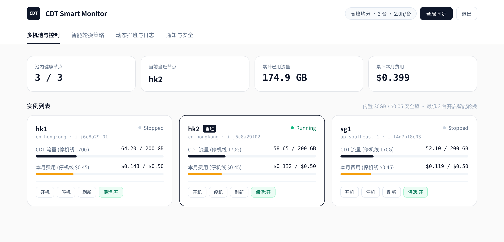

<div align="center">

# CDT Smart Monitor

**轻量化多机云服务器运维、流量监控与动态排班管理面板**

[](https://go.dev/)
[](#架构设计)
[](#快速部署)
[](#安全与认证)
[](LICENSE)

[核心特性](#核心特性) · [界面预览](#界面预览) · [快速部署](#快速部署) · [排班与保护机制](#排班与保护机制) · [RAM 最小权限](#阿里云-ram-最小权限) · [致谢](#致谢与开源协议)

</div>

---

## 简介

**CDT Smart Monitor** 是一款面向阿里云 ECS / CDT 多实例场景的轻量化单容器机器管理面板。项目完全基于 Go 1.24 标准库编写（**零第三方依赖**，静态编译体积小、部署简单），将多机实时状态监控、一键启停控制、流量与费用阈值保护、24 小时动态均衡排班、手动接管调度、抢占式实例保活以及 WebAuthn Passkey 安全认证整合进单一服务进程。

---

## 界面预览

### 多机池与实时控制


### 24 小时动态排班与调度日志


---

## 核心特性

| 模块 | 能力说明 |
| :--- | :--- |
| **多机集中监控与控制** | 统一纳管多台云服务器实例，实时同步运行状态、公网 IP、当月 CDT 流量与费用消耗，支持单机/全局刷新及一键开机、节省停机（`StopCharging`）。 |
| **平滑加权动态负载均衡排班** | 根据各节点剩余流量/费用配额健康度与容量规模，自动生成 24 小时连续块排班表并实时展示全池均衡度，兼顾高峰期稳定运行与多机负载平滑均衡。 |
| **手动 / 自动值班无缝切换** | 支持随时点选任意健康节点即时接管当班，也可直接点击 24 小时排班表逐小时调整值班机器或设置休眠；支持按槽位、固定时长、次日零点自动切回或一键回归智能排班。 |
| **双维度阈值保护** | 每台实例可独立配置流量上限与费用上限，系统内置安全缓冲余量以抵御云端统计延迟，支持刷新增幅异常急停与高峰单班突发上限配置。 |
| **无感交接（Make-Before-Break）** | 换班时先启动接班实例并确认进入 `Running` 状态，再对旧机执行节省停机，降低切换过程中的业务中断风险。 |
| **抢占式实例保活** | 当班抢占式实例意外停机时自动尝试拉起，连续失败后自动故障转移至备用节点；阈值保护与闲时关机策略始终拥有更高优先级。 |
| **通知与代理支持** | 支持 Telegram Bot 与自定义 Webhook 告警及定时周报；内置 `HTTP / HTTPS / SOCKS5` 代理与自定义 Telegram API 反代配置，支持一键测试。 |
| **现代安全认证** | 首次访问初始化本地管理员密码（加盐 PBKDF2-HMAC-SHA256）、`HttpOnly` Session、登录限速，以及 HTTPS 环境下的 **WebAuthn Passkey（Face ID / Touch ID / Windows Hello）** 免密登录。 |

---

## 架构设计

```text
Browser (极简白色管理面板 · go:embed)
   │  Session Cookie / HTTPS WebAuthn Passkey (ES256)
   ▼
Go 1.24 HTTP Server (零第三方依赖)
   ├──► 1 分钟内置调度器 ──► 排班与保护引擎 (平滑加权均衡 / 手动接管 / 阈值保护 / 保活)
   ├──► 阿里云 RPC 客户端 ──► CDT (流量) · ECS (启停/状态) · BSS (费用统计)
   ├──► 通知投递器        ──► Telegram (支持反代与 SOCKS5/HTTP 代理) · Webhook
   └──► 原子状态存储      ──► /data/state.json + /data/master.key (AES-256-GCM)
```

---

## 快速部署

### 方式一：Docker Compose 直接拉取镜像（推荐）

```yaml
services:
  cdt-smart-monitor:
    image: bbplin/cdt-smart-monitor:latest
    container_name: cdt-smart-monitor
    user: "0:0"
    restart: unless-stopped
    init: true
    ports:
      - "43211:8080"
    environment:
      CDT_DATA_DIR: /data
      CDT_LISTEN: :8080
      TZ: Asia/Shanghai
    volumes:
      - ./data:/data
```

```bash
docker compose up -d
```

### 方式二：源码本地构建

```bash
git clone https://github.com/yellowdking/cdt-smart-monitor.git
cd cdt-smart-monitor
docker compose up -d --build
```

启动后浏览器访问 `http://服务器IP:43211`，按引导设置本地管理员密码即可进入管理面板。

---

## 排班与保护机制

1. **自定义配额保护（安全缓冲兜底）**
   - 每台机器均可独立设定流量上限与费用上限，系统在阈值前自动保留安全缓冲以应对云端监控与出账延迟；触发保护线后自动停机并锁定至下一计费周期重置，手动值班模式下同样受保护线约束。
2. **动态均衡排班与手动接管**
   - 活跃时段外可自动全池停机；活跃与高峰时段结合各节点剩余配额比例与容量规模平滑分配连续值班时段，并按日轮转黄金高峰槽位。
   - 运维人员可随时在主界面一键指定当班节点，或在 24 小时排班表中点击任意小时进行精准调整，并可随时一键恢复自动排班。

---

## 阿里云 RAM 最小权限

建议为监控面板创建独立 RAM 子用户，仅授予以下最小权限策略：

| 权限策略 | 用途 |
| :--- | :--- |
| `AliyunECSFullAccess`（或限定单实例启停与查询） | 查询实例状态、公网 IP，执行开机与节省停机（`StopCharging`） |
| `AliyunCDTReadOnlyAccess` | 查询当月 CDT 公网流量统计 |
| `AliyunBSSReadOnlyAccess` | 查询当月实例费用统计 |

---

## 安全与认证

- **凭据加密**：所有阿里云 `AccessKey Secret` 与 Telegram `Bot Token` 均通过 `/data/master.key` 使用 **AES-256-GCM** 加密后落盘。请务必备份整个 `data/` 目录，切勿提交到 Git。
- **启用 HTTPS Passkey**：公网部署建议通过 Nginx / Caddy 反向代理启用 HTTPS，并透传 `Host` 与 `X-Forwarded-Proto: https` 请求头，即可在「通知与安全」页面绑定设备 Passkey 通行密钥。

---

## 致谢与开源协议

- 本项目的阿里云 CDT / ECS / BSS 接口监控思路参考自开源项目 **[wang4386/CDT-Monitor](https://github.com/wang4386/CDT-Monitor)**（MIT License），在此向原作者及社区贡献者表示感谢。
- 本项目基于 [MIT License](LICENSE) 协议开源。
