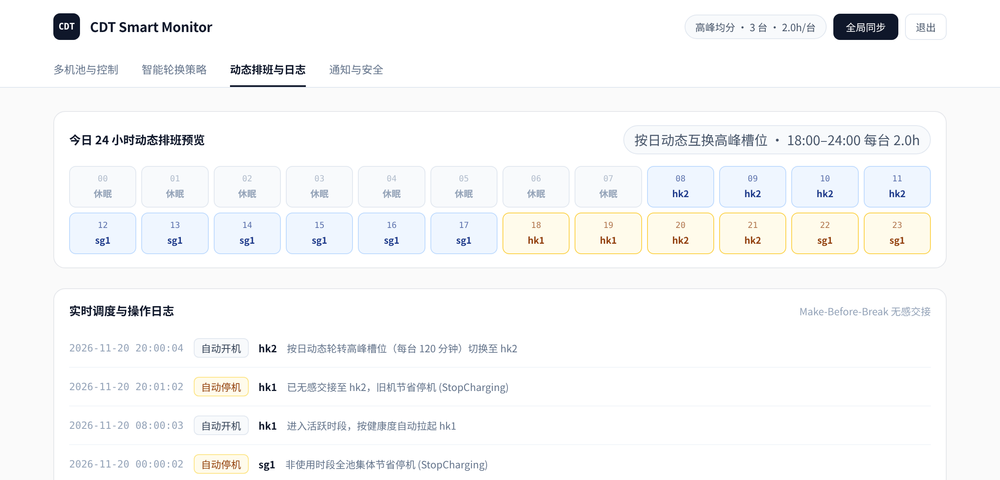

<div align="center">

# CDT Smart Monitor

**面向阿里云国际站 200GB 免费 CDT 流量与 $0.50 抹零规则的轻量化多机智能轮换与双阈值风控控制台**

[](https://go.dev/)
[](#架构设计)
[](#快速部署)
[](#安全与认证)
[](LICENSE)

[核心特性](#核心特性) · [界面预览](#界面预览) · [快速部署](#快速部署) · [风控与轮换机制](#风控与轮换机制) · [RAM 最小权限](#阿里云-ram-最小权限) · [致谢](#致谢与开源协议)

</div>

---

## 简介

**CDT Smart Monitor** 是一款专为阿里云国际站（同时兼容中国站）ECS 实例打造的轻量化单容器运维面板。它基于纯 Go 1.24 标准库编写（**零第三方依赖**，静态编译体积小、构建快），将多机状态同步、CDT 流量与 BSS 账单双阈值熔断、动态高峰均衡轮换、抢占式实例保活以及 WebAuthn Passkey 安全认证整合进单一进程。

只需将至少 **2 台** 实例加入轮换池，系统即可在全月 30 天内自动调度开关机，兼顾高峰期稳定体验与极致的成本控制。

---

## 界面预览

### 多机池与实时控制


### 24 小时动态排班与调度日志


---

## 核心特性

| 模块 | 能力说明 |
| :--- | :--- |
| **双维度自定义熔断** | 每台实例独立设置流量上限（默认 `200 GB`）与金额上限（默认 `$0.50`）；底层自动内置 `30 GB` 流量安全垫与 `$0.05` 金额安全垫，抵御阿里云 API 出账延迟。 |
| **刷新差值急停与优先级** | 非高峰相邻两次刷新流量增幅 `> 30 GB`、或全时段金额增幅 `> $0.05` 立即停机切机；高峰期「单班突发上限」优先级高于全局 30GB 差值限制，保障业务不中断。 |
| **动态自平衡轮换** | 最低 **2 台机**起步；非使用时段全池集体节省停机（`StopCharging`）；高峰期按健康机数自动均分时长，日常按天互换槽位，余量差 `≥ 20%` 时自动由余量最充裕节点顶班。 |
| **无感交接（Make-Before-Break）** | 正常换班先拉起接班实例，确认进入 `Running` 状态后再对旧机执行节省停机，避免业务闪断。 |
| **抢占式实例保活** | 当班抢占式实例被回收停机后自动拉起，连续失败 3 次自动故障转移至备机；**阈值熔断与闲时关机优先级始终高于保活**。 |
| **通知与代理支持** | 支持 Telegram Bot 与自定义 Webhook 通知；内置 `HTTP / HTTPS / SOCKS5` 代理与自定义 Telegram API 反代地址，支持一键实时测试。 |
| **现代安全认证** | 首次访问初始化本地管理员密码（加盐 PBKDF2-HMAC-SHA256）、`HttpOnly` Session、IP 登录限速，以及 HTTPS 环境下的 **WebAuthn Passkey（Face ID / Touch ID / Windows Hello）** 免密登录。 |

---

## 架构设计

```text
Browser (极简白色控制台 · go:embed)
   │  Session Cookie / HTTPS WebAuthn Passkey (ES256)
   ▼
Go 1.24 HTTP Server (零第三方依赖)
   ├──► 1 分钟内置调度器 ──► 策略引擎 (双阈值 / 刷新差值 / 动态自平衡 / 保活)
   ├──► 阿里云 RPC 客户端 ──► CDT (流量) · ECS (启停/状态) · BSS (国际/国内账单)
   ├──► 通知投递器        ──► Telegram (支持反代与 SOCKS5/HTTP 代理) · Webhook
   └──► 原子状态存储      ──► /data/state.json + /data/master.key (AES-256-GCM)
```

---

## 快速部署

### 方式一：Docker Compose 直接拉取镜像（推荐）

```yaml
services:
  cdt-smart-monitor:
    image: <你的DockerHub用户名>/cdt-smart-monitor:latest
    container_name: cdt-smart-monitor
    user: "0:0"
    restart: unless-stopped
    init: true
    ports:
      - "43211:8080"
    environment:
      CDT_DATA_DIR: /data
      CDT_LISTEN: :8080
      TZ: Asia/Shanghai
    volumes:
      - ./data:/data
```

```bash
docker compose up -d
```

### 方式二：源码本地构建

```bash
git clone https://github.com/yellowdking/cdt-smart-monitor.git
cd cdt-smart-monitor
docker compose up -d --build
```

启动后浏览器访问 `http://服务器IP:43211`，按引导设置本地管理员密码即可进入控制台。

---

## 风控与轮换机制

1. **内部统一安全垫（无需手动调缓冲）**
   - 默认 `200 GB` 流量上限 → 实际 `170 GB` 触发熔断停机并锁定至次月 1 日 `00:05`。
   - 默认 `$0.50` 金额上限 → 实际 `$0.45` 触发熔断停机并锁定至次月 1 日 `00:05`。
2. **高峰自动均分与动态纠偏**
   - 例如高峰期设为 `18:00–24:00`（6 小时）：2 台健康机自动均分为 `3.0 小时/台`，3 台自动均分为 `2.0 小时/台`。
   - 余量均衡时每天自动顺延互换高峰槽位；一旦任意两台机剩余余量差 `≥ 20%`，系统自动由余量最多的一台顶班高峰，直至进度拉齐。

---

## 阿里云 RAM 最小权限

建议为监控账号创建独立 RAM 子用户，仅授予以下最小权限策略：

| 权限策略 | 用途 |
| :--- | :--- |
| `AliyunECSFullAccess`（或限定单实例启停与查询） | 查询实例状态、公网 IP，执行开机与节省停机（`StopCharging`） |
| `AliyunCDTReadOnlyAccess` | 查询当月 CDT 公网流量（自动区分国内与海外/香港） |
| `AliyunBSSReadOnlyAccess` | 查询阿里云国际站（USD）或国内站（CNY）当月账单 |

---

## 安全与认证

- **凭据加密**：所有阿里云 `AccessKey Secret` 与 Telegram `Bot Token` 均通过 `/data/master.key` 使用 **AES-256-GCM** 加密后落盘。请务必备份整个 `data/` 目录，切勿提交到 Git。
- **启用 HTTPS Passkey**：公网部署建议通过 Nginx / Caddy 反向代理启用 HTTPS，并透传 `Host` 与 `X-Forwarded-Proto: https` 请求头，即可在「通知与安全」页面绑定设备 Passkey 通行密钥。

---

## 致谢与开源协议

- 本项目的核心场景、阿里云 CDT/ECS/BSS 监控设计思路参考自开源项目 **[wang4386/CDT-Monitor](https://github.com/wang4386/CDT-Monitor)**（MIT License），在此向原作者及社区贡献者表示诚挚感谢！
- 本项目基于 [MIT License](LICENSE) 协议开源。
